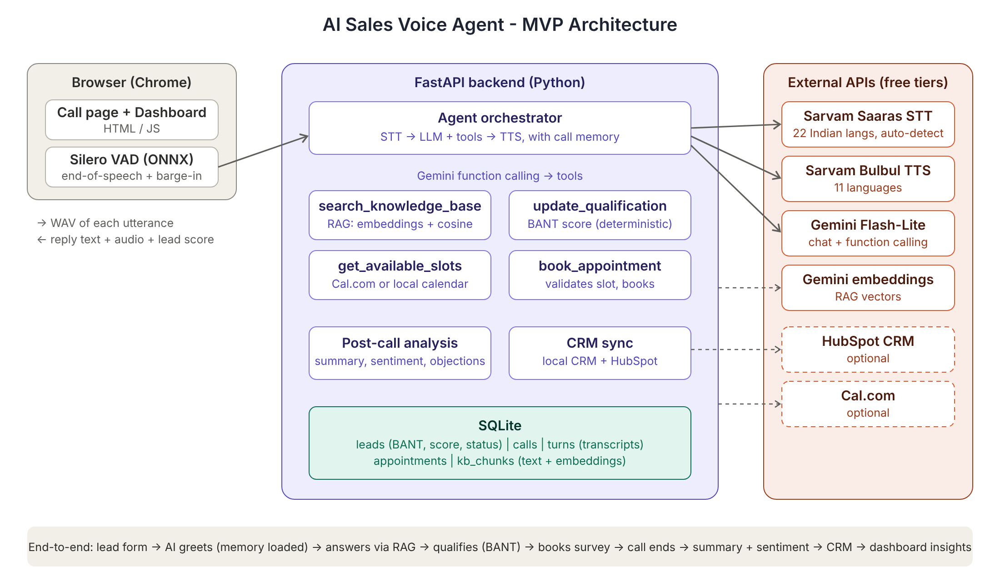
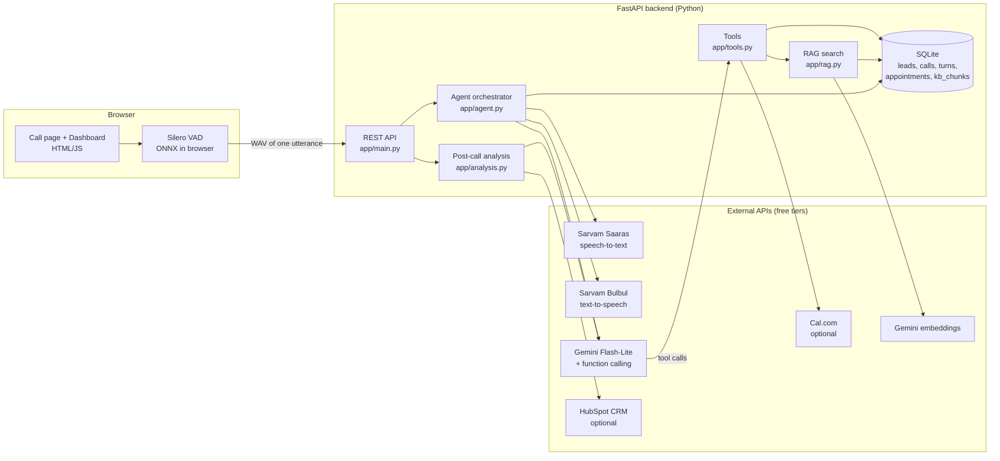
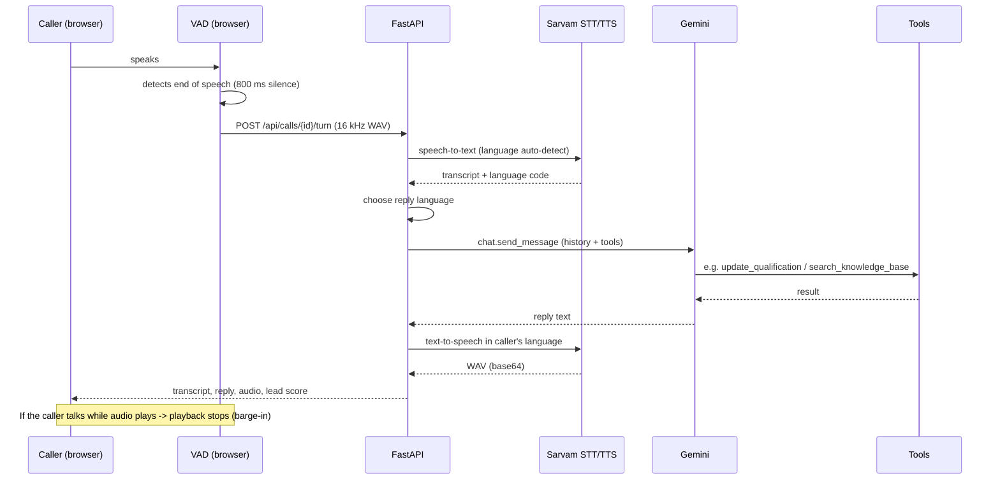
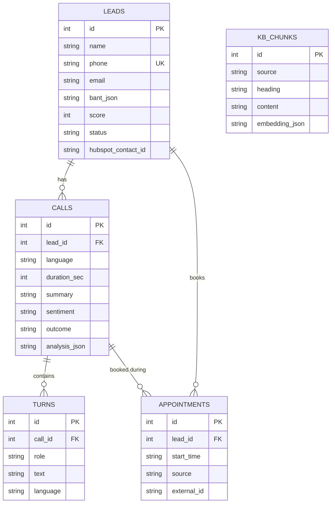

# System Architecture (MVP)

## Components

## One conversation turn

## Call lifecycle

1. **Start** (`POST /api/calls/start`): find-or-create lead by phone -> build system prompt with
   **long-term memory** (BANT so far, last 3 call summaries, existing bookings) -> Gemini greets.
2. **Turns** (`/turn` or `/text`): STT -> LLM with tools -> TTS. Chat history = **short-term memory**.
3. **End** (`POST /api/calls/{id}/end`): Gemini returns structured JSON (summary, sentiment, trend,
   objections, buying signals, next step, outcome) -> saved -> CRM sync (local + HubSpot).
4. **Dashboard**: KPIs, objections, language mix, leads, appointments, transcripts, AI insights.

## Key design decisions (and why)

| Decision | Why |
|---|---|
| Cascaded STT -> LLM -> TTS (not speech-to-speech) | Brief asks for STT/TTS; text at every step feeds CRM, sentiment, summaries; provider per stage can be swapped |
| VAD in the browser | No audio streaming server needed for the MVP; only finished utterances are sent, so STT cost = speech time only |
| Sarvam for speech | Built for Indian languages and code-mixed Hinglish; free credits |
| Gemini function calling for actions | The LLM decides *when* to search/qualify/book; tools enforce rules (valid criterion, slot really free) |
| Deterministic BANT scoring in Python | Explainable, testable, same input -> same score |
| SQLite + numpy vector search | Zero setup for the MVP; same schema moves to PostgreSQL + pgvector |
| Local fallbacks for CRM and calendar | Demo never depends on optional third-party accounts |
| Tools never raise exceptions | They return error text so the LLM can recover ("slot taken -> offer another") |

## Data model

