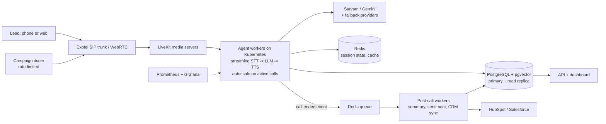

# Scaling to 1,00,000 Users, Security, Deployment and Costs

## 1. What "1 lakh users" means in load

Assumption (state it in the presentation): 1,00,000 leads/month, ~1 call each, 4 min average call,
calls happen 10 hours/day, 26 days/month.

| Metric | Value |
|---|---|
| Call-minutes / month | 4,00,000 |
| Average concurrent calls | ~26 |
| Peak concurrent calls (3x) | ~77 |
| Design target with headroom | 150 concurrent calls |

The hard limits are **AI provider rate limits, telephony channels and cost**, not CPU or the database.

## 2. Target architecture

## 3. What changes from the MVP, and why

| MVP (today) | Production | Reason |
|---|---|---|
| Turn-based REST (~2-4 s reply) | Streaming pipeline over WebRTC/SIP with LiveKit Agents; stream STT, stream LLM tokens, start TTS on first sentence | Get reply latency under ~1 s; proper barge-in and turn detection |
| Browser only | Exotel SIP trunk into LiveKit SIP for inbound/outbound phone calls | Real phone calls in India |
| In-memory sessions | Stateless agent workers; call state in Redis | Any worker can serve any call; pods can scale and restart |
| One FastAPI process | Separate deployments: agent workers, API, post-call workers, dialer | Scale each part independently |
| Post-call analysis inline | Redis queue + worker pool, retries, idempotent jobs | Never slows live calls; survives failures |
| SQLite + numpy | PostgreSQL + pgvector (HNSW index), PgBouncer, read replica for dashboard | Concurrent writes, durable, fast vector search |
| Single AI provider | Provider abstraction + fallback (e.g. Sarvam <-> Deepgram, Gemini Flash-Lite <-> Flash), quota increases | Rate limits and outages are the real bottleneck |
| No autoscaling | Kubernetes HPA/KEDA on active-session count; load-test to find sessions per pod | Pay for what is used |
| Logs only | Prometheus + Grafana: per-stage latency (STT, LLM first token, TTS first byte), error rate, cost per call | Find bottlenecks, control cost |
| - | Region: AWS Mumbai (ap-south-1) | Latency + data residency |

**Rollout path**: MVP -> pilot (1k users: Postgres, Redis, Docker on one VM) -> production (Kubernetes,
LiveKit, telephony) -> load test at 150 concurrent synthetic calls before go-live.

## 4. Security and compliance

- **Secrets** in environment variables / a secrets manager, never in code (`.env` is git-ignored).
- **Encryption**: TLS in transit; encrypted database and object storage at rest.
- **PII minimisation**: mask phone numbers in logs; recordings/transcripts deleted after a retention period.
- **Access control**: dashboard behind login (JWT) with roles (agent, manager, admin).
- **LLM safety**: the LLM never sees API keys or IDs; every tool validates input server-side (valid BANT
  criterion, slot really free, lead bound by closure); LLM output is HTML-escaped in the UI;
  prompt instructs the agent to disclose it is an AI and never invent prices.
- **DPDP Act 2023 + DPDP Rules 2025** (phased; most obligations from 13 May 2027): consent at call start,
  purpose limitation, data-deletion requests, breach reporting.
- **TRAI**: automated/AI calls are application-to-person (A2P) calls that must be declared to the
  telecom provider; promotional calls must use the 140-series and respect DND preferences.

## 5. Costs

**MVP: Rs 0** - Gemini free tier, Sarvam free credits, SQLite, free HubSpot/Cal.com, runs on a laptop.

**At 1 lakh users (4 lakh call-minutes/month)** - list prices checked Nov 2026, USD = Rs 95:

| Per call-minute | Launch | Optimised |
|---|---|---|
| STT (Sarvam, Rs 30/hour) | Rs 0.50 | Rs 0.45 (volume tier) |
| TTS (Bulbul v3 Rs 30 / 10k chars; v2 Rs 15) | Rs 1.35 | Rs 0.68 |
| LLM live (Gemini 3.5 Flash-Lite) | Rs 0.27 | Rs 0.27 |
| Post-call analysis | Rs 0.36 (Flash) | Rs 0.05 (Flash-Lite) |
| Telephony (Exotel, ~Rs 0.5-1.5/min estimate) | Rs 1.00 | Rs 1.00 |
| LiveKit Cloud agent minutes ($0.01) | Rs 0.95 | Rs 0 (self-hosted) |
| **Total** | **Rs 4.42/min (Rs 17.7/call)** | **Rs 2.44/min (Rs 9.8/call)** |

Monthly: about **Rs 9.8-17.7 lakh** + fixed infrastructure (Kubernetes nodes, Postgres, Redis - price
with the AWS calculator).

**Business case**: a telecaller costs ~Rs 21,000/month; 4 lakh talk-minutes would need ~64 telecallers
(assuming 4 h talk/day) = ~Rs 13.6 lakh salary alone. So the AI is not dramatically cheaper per minute
in India. The value is: every lead called within seconds, 24x7, in their language; human closers only
spend time on HOT leads; every call becomes structured CRM data. As a SaaS product, AI-only cost of
~Rs 1.44/min leaves margin against market prices of ~Rs 4-6/min.
